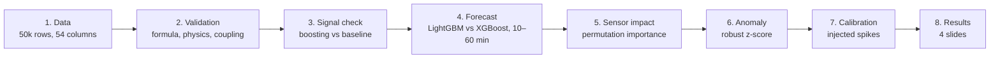
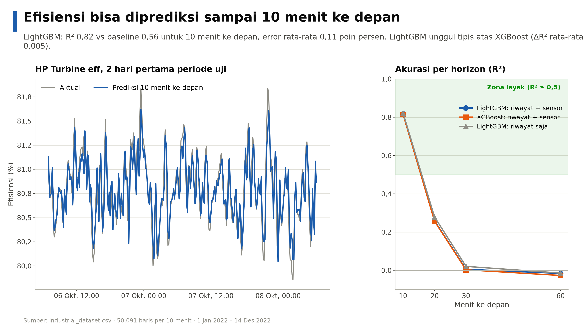
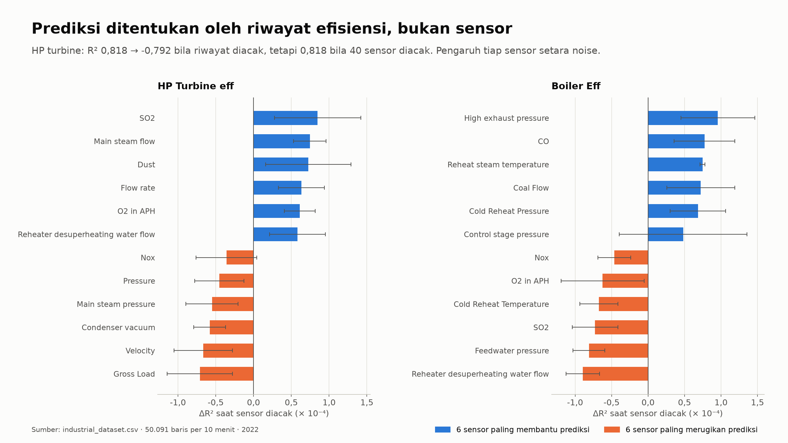
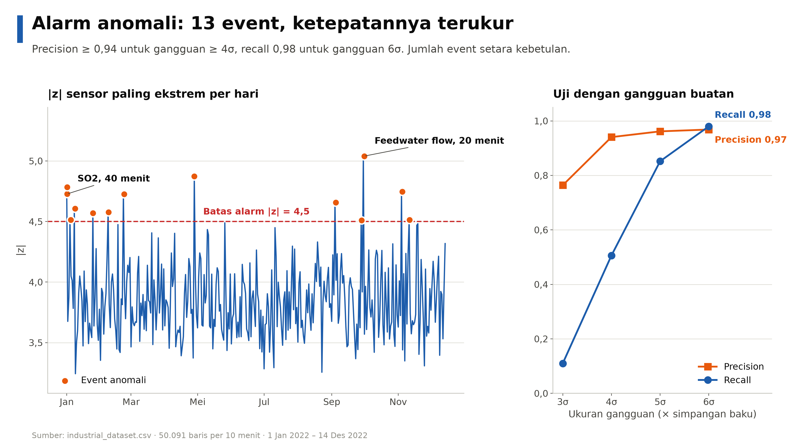

# Power Plant Data Validation, Efficiency Forecasting & Sensor Anomaly Detection

[](https://colab.research.google.com/github/aldo02032004/power-plant-validation-forecast-anomaly/blob/main/power_plant_validation_forecast_anomaly.ipynb)


A one-year sensor log from a coal-fired power plant (50,091 rows, one every 10 minutes in 2022), checked before it is modelled. The notebook tests whether the numbers obey their own physics formulas. It then forecasts boiler and turbine efficiency with LightGBM and XGBoost and measures which sensors drive the forecast. Finally, it flags abnormal sensor readings with a detector whose precision and recall are measured.


## Questions answered

1. Are the derived columns consistent with their thermodynamic formulas?
2. Can HP turbine and boiler efficiency be predicted, and how far ahead?
3. Which sensors help the efficiency forecast most, and which hurt it?
4. When do sensors read abnormally, and how reliable is the detector?

## Pipeline



| Step | What happens | Main output |
|---|---|---|
| 1. Data | CSV from Google Drive. Columns are split into targets, derived (formula) columns, and 40 measured sensors | `df`, `SENSOR` |
| 2. Validation | 12 checks with a pass rule: formulas match in ≥ 99% of rows, physics holds in ≥ 99% of rows, coupled sensors have Spearman ρ ≥ 0.5 | `validasi` |
| 3. Signal check | Gradient boosting vs a mean baseline, R² with `TimeSeriesSplit` (5 folds), with and without the leaky derived columns | `sinyal` |
| 4. Forecast | LightGBM and XGBoost on the last 6 efficiency readings plus the latest sensor values, 10, 20, 30 and 60 minutes ahead. Trained on the first 80% of the period, tested on the last 20%, compared with persistence and a history-only model. The better model per target is kept | `hasil`, `model` |
| 5. Sensor impact | Permutation importance of the better model on the test period: how much R² drops when one sensor is shuffled, repeated 5 times; plus the R² when all history or all sensors are shuffled together | `pengaruh`, `ringkas` |
| 6. Anomaly | Robust z-score per sensor (median / MAD). A row is flagged when any sensor has abs(z) > 4.5, and consecutive rows are merged into one event | `event` |
| 7. Calibration | 1% of rows get a known spike of 3–6 σ on 1–3 sensors, and recall and precision are measured | `kalibrasi` |
| 8. Results | Validation, forecast, sensor-impact and alarm slides (16:9, 3520 × 1980 px) | `images/01-04_*.png` |

## Results

| Check | Value | Meaning |
|---|---|---|
| Physics (Nett < Gross, 10-minute interval, no missing values) | 100% of rows | Format and basic limits pass |
| η HP = ΔP ÷ ΔH isentropic × 100 | 11.6% of rows match | The efficiency column does not follow its own formula |
| Main steam flow ↔ Gross Load | ρ = −0.002 | Physically coupled sensors do not move together |
| Highest abs(ρ) among all 1,431 column pairs | 0.023 | Every column varies independently |
| R², sensors only (same time) | ≤ 0 for both targets | Sensors cannot explain efficiency, even with leaky columns |
| Forecast R², 10 min ahead (LightGBM) | 0.82 (persistence 0.56), MAE 0.11 pp | Efficiency is predictable a short step ahead |
| LightGBM vs XGBoost | LightGBM ahead by 0.005 R² on average | The two are practically equal |
| Forecast R², 30 / 60 min ahead | ≈ 0 | The skill is gone after 30 minutes |
| R² with all history / all sensors shuffled | −0.79 / 0.82 | The forecast comes from the efficiency's own history |
| Strongest single sensor effect | ±1 × 10⁻⁴ R² | No sensor matters more than shuffling noise |
| Detector precision / recall at 6 σ | 0.97 / 0.98 | Calibrated on injected spikes |
| Flagged rows on the real data | 17 rows, 13 events | About what chance alone gives (≈ 14 rows) |

Key findings:
- **The data passes format checks but fails physics checks.** Derived columns do not match their formulas, and no two columns are correlated, so the file behaves like synthetic data generated column by column.
- **Efficiency can be forecast 10 minutes ahead (R² 0.82), not further.** The forecast relies on the efficiency's own recent history. Adding 40 sensors does not improve it (0.818 vs 0.822).
- **No sensor drives efficiency in this data.** The most helpful sensor (SO2 for the HP turbine) and the most harmful one (Gross Load) both move R² by about 1 × 10⁻⁴, the size of shuffling noise. This matches the validation result.
- **The anomaly detector is validated without labels.** With injected spikes, precision is 0.94 or higher from 4 σ upward, and recall rises from 0.13 at 3 σ to 0.98 at 6 σ. The same method can run unchanged on real DCS data.





Every finding, slide title and the conclusion are generated from the results, so they stay correct when the data grows or shrinks (tested on a 15,000-row subset).

## Data

`industrial_dataset.csv` (50 MB) is downloaded from Google Drive by `gdown` on the first run and is not stored in this repository. It has 55 columns: steam, feedwater, flue gas and emission sensors, enthalpies, heat rates, efficiencies and load.

## How to run

**Google Colab (easiest):** click the *Open in Colab* badge and run all cells.

**Locally:**
```bash
git clone https://github.com/aldo02032004/power-plant-validation-forecast-anomaly.git
cd power-plant-validation-forecast-anomaly
pip install -r requirements.txt
jupyter notebook power_plant_validation_forecast_anomaly.ipynb
```

## Limitations and next steps

- The detector looks at one sensor at a time. A fault that shows only as a broken relationship between sensors needs a multivariate model, and on this data no such relationship exists to learn.
- The 4.5 threshold trades recall for precision. Lower it if small faults matter more than false alarms.
- The forecast uses a single train/test split with fixed LightGBM and XGBoost settings. That is enough here because the gap to persistence is large, but real data would deserve rolling-origin backtests and tuning.
- **Next step:** run the same pipeline on real plant DCS data. If the validation passes, the sensor-impact slide becomes a list of operating levers.

## License

[MIT](LICENSE) © 2026 Naufaldo Indra Pratama
