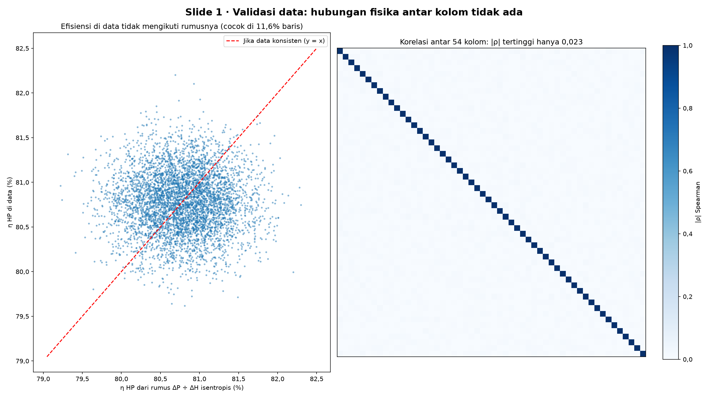
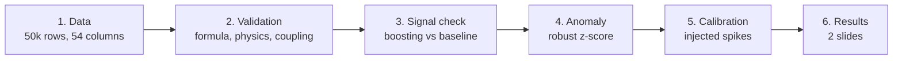
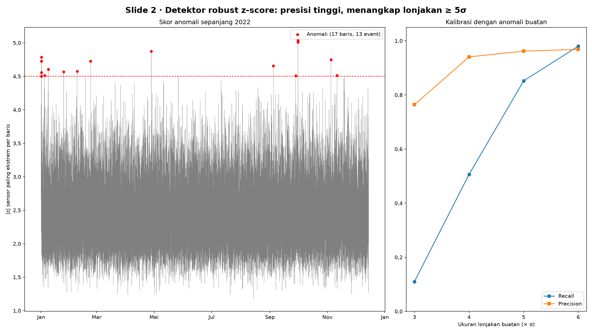

# Power Plant Data Validation & Sensor Anomaly Detection

[](https://colab.research.google.com/github/aldo02032004/power-plant-anomaly/blob/main/power_plant_anomaly.ipynb)


A one-year sensor log from a coal-fired power plant (50,091 rows, one every 10 minutes in 2022), checked before it is modelled. The notebook tests whether the numbers obey their own physics formulas. It then asks whether boiler and turbine efficiency can be predicted, and it flags abnormal sensor readings with a detector whose precision and recall are measured.



## Questions answered

1. Are the derived columns consistent with their thermodynamic formulas?
2. Can HP turbine and boiler efficiency be predicted from the 40 sensors?
3. When do sensors read abnormally, and how reliable is the detector?

## Pipeline



| Step | What happens | Main output |
|---|---|---|
| 1. Data | CSV from Google Drive. Columns are split into targets, derived (formula) columns, and 40 measured sensors | `df`, `SENSOR` |
| 2. Validation | 12 checks with a pass rule: formulas match in ≥ 99% of rows, physics holds in ≥ 99% of rows, coupled sensors have Spearman ρ ≥ 0.5 | `validasi` |
| 3. Signal check | Gradient boosting vs a mean baseline, R² with `TimeSeriesSplit` (5 folds), with and without the leaky derived columns | `sinyal` |
| 4. Anomaly | Robust z-score per sensor (median / MAD). A row is flagged when any sensor has abs(z) > 4.5, and consecutive rows are merged into one event | `event` |
| 5. Calibration | 1% of rows get a known spike of 3–6 σ on 1–3 sensors, and recall and precision are measured | `kalibrasi` |
| 6. Results | Validation and detector slides (16:9) | `images/01-02_*.png` |

## Results

| Check | Value | Meaning |
|---|---|---|
| Physics (Nett < Gross, 10-minute interval, no missing values) | 100% of rows | Format and basic limits pass |
| η HP = ΔP ÷ ΔH isentropic × 100 | 11.6% of rows match | The efficiency column does not follow its own formula |
| Main steam flow ↔ Gross Load | ρ = −0.002 | Physically coupled sensors do not move together |
| Highest abs(ρ) among all 1,431 column pairs | 0.023 | Every column varies independently |
| R², boosting vs baseline | ≤ 0 for both targets | Efficiency cannot be predicted, even with leaky columns |
| Detector precision / recall at 6 σ | 0.97 / 0.98 | Calibrated on injected spikes |
| Flagged rows on the real data | 17 rows, 13 events | About what chance alone gives (≈ 14 rows) |

Key findings:
- **The data passes format checks but fails physics checks.** Derived columns do not match their formulas, and no two columns are correlated, so the file behaves like synthetic data generated column by column.
- **The earlier R² ≈ 0 came from the data, not from weak tuning.** Neither Optuna nor more features can fix it, so the notebook stops before tuning or SHAP.
- **The anomaly detector is validated without labels.** With injected spikes, precision is 0.94 or higher from 4 σ upward, and recall rises from 0.11 at 3 σ to 0.98 at 6 σ. The same method can run unchanged on real DCS data.



## Data

`industrial_dataset.csv` (50 MB) is downloaded from Google Drive by `gdown` on the first run and is not stored in this repository. It has 55 columns: steam, feedwater, flue gas and emission sensors, enthalpies, heat rates, efficiencies and load.

## How to run

**Google Colab (easiest):** click the *Open in Colab* badge and run all cells.

**Locally:**
```bash
git clone https://github.com/aldo02032004/power-plant-anomaly.git
cd power-plant-anomaly
pip install -r requirements.txt
jupyter notebook power_plant_anomaly.ipynb
```

## Limitations and next steps

- The detector looks at one sensor at a time. A fault that shows only as a broken relationship between sensors needs a multivariate model, and on this data no such relationship exists to learn.
- The 4.5 threshold trades recall for precision. Lower it if small faults matter more than false alarms.
- **Next step:** run the same validation on real plant DCS data. Once the checks pass, an efficiency model with SHAP becomes meaningful.

## License

[MIT](LICENSE) © 2026 Naufaldo Indra Pratama
